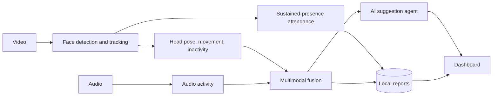

# Multimodal Attendance & Engagement Agent

An offline, privacy-preserving classroom assistant. It analyses a recorded session (video + audio)
and produces **automatic attendance**, **engagement trends**, **per-student analytics** and **teaching suggestions**
in a simple dashboard.

- **Attendance by sustained presence:** a person counts only after being seen continuously, so quick passes don't.
- **Multimodal engagement:** head orientation, movement, inactivity and audio activity are fused into one score.
- **AI teaching suggestions:** a local agent flags attention dips, low participation and late arrivals.
- **Private by design:** everything runs and is stored locally. No cloud calls, no face recognition, no names.

## Architecture



More detail: [docs/ARCHITECTURE.md](docs/ARCHITECTURE.md)

## Quick start

```bash
git clone <your-repo-url>
cd multimodal-attendance-engagement-agent
python -m venv .venv
source .venv/bin/activate        # Windows: .venv\Scripts\activate
pip install -r requirements.txt
python app.py
```

Open http://127.0.0.1:5000. The dashboard starts with demo data.

**One-step launch:** double-click `run.bat` (Windows) or run `./run.sh` (Mac/Linux). It creates the environment, installs everything and starts the app.

### Two ways to use it

- **Live session:** open the **Live session** tab, click **Start session**, allow camera and microphone access, then click **Stop and analyse**. You see the camera preview with detected faces and a live count of who is marked present.
- **Recorded video:** open **Analyse a video**, pick a file and click **Analyse video**.

Tip for short demos: choose a 30-second window and a short presence time (20 seconds), so a one or two minute clip produces results.

Optional: install [ffmpeg](https://ffmpeg.org) so audio is extracted from videos automatically. Without it, pass a WAV with `--audio` or run video-only (the score still works).

### Command line

```bash
python -m src.pipeline --video classroom.mp4 --expected 30
python -m src.pipeline --video demo.mp4 --window-sec 30 --min-presence-sec 20   # short clips
```

Results are written to `data/reports/latest.json` and `data/reports/attendance.csv`.

## Troubleshooting

| Problem | Fix |
|---|---|
| Camera does not open | Close Zoom, Teams or other apps using it. On Mac, allow Terminal or your editor under System Settings, Privacy, Camera. |
| "no microphone (video-only score)" | Allow microphone access, or run `pip install sounddevice`. Scoring still works without audio. |
| "0 present" | Face the camera in good light, and stay in view longer than the presence time. |
| `activate` blocked in PowerShell | Use Command Prompt, or run `Set-ExecutionPolicy -Scope Process RemoteSigned`. |
| Port 5000 busy | Change `port=5000` in `app.py`. |

## Project structure

```
app.py                Flask dashboard and upload route
src/config.py         Tunable settings (windows, thresholds, weights)
src/vision.py         Face detection, tracking, head-pose and movement signals
src/audio.py          Speech/activity detection from audio
src/live.py           Live webcam + microphone session
src/attendance.py     Sustained-presence logic
src/fusion.py         Multimodal fusion and engagement score
src/agent.py          Teaching suggestion agent
src/pipeline.py       End-to-end pipeline, report builder, CLI
src/sample.py         Demo data
templates/, static/   Dashboard UI
tests/                Unit tests (pytest)
docs/ARCHITECTURE.md  Architecture and scoring notes
```

## Tests

```bash
pytest -q
```

## Limitations and roadmap

- Head pose uses OpenCV frontal/profile detection as a proxy. Next step: MediaPipe Face Mesh for true yaw and pitch.
- Faces get anonymous IDs (Person 1, 2, ...). A consent-based roster match could be added.
- Audio measures activity, not who is speaking. Speaker separation is future work.
- The suggestion agent is rule-based. A local LLM (for example via Ollama) can be plugged into `src/agent.py`.
- Live mode runs on one camera and one microphone; multi-camera support is future work.

## License

MIT, see [LICENSE](LICENSE).
