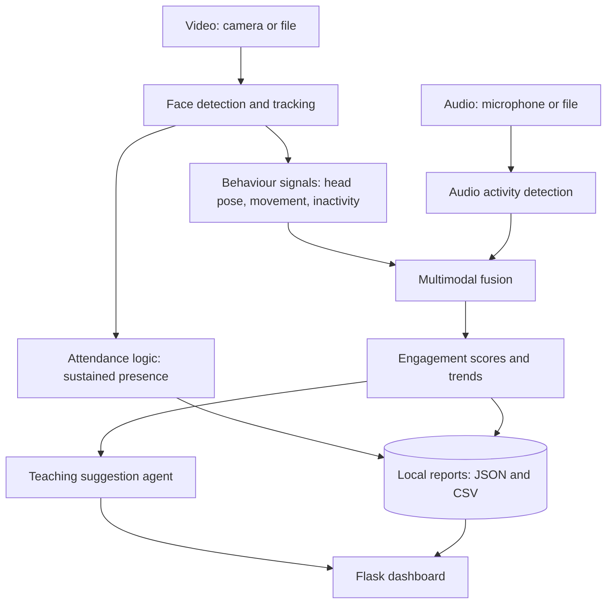

# Architecture

| Layer | Module | Responsibility |
|---|---|---|
| Input | `src/vision.py`, `src/audio.py` | Read video frames and audio |
| Analysis | `src/vision.py`, `src/attendance.py` | Detect and track faces, mark sustained presence |
| Fusion | `src/fusion.py` | Combine visual and audio signals into a 0 to 100 score |
| Agent | `src/agent.py` | Turn trends into plain-language suggestions |
| Orchestration | `src/pipeline.py` | Run the steps, build and save the report |
| Presentation | `app.py`, `templates/`, `static/` | Dashboard, upload form, CSV download |
| Storage | `data/` | Local files only. Nothing leaves the machine |

## Scoring

Each window gets four signals (0 to 1): head pose (share of frames facing the front), movement (steadiness),
activity (share of frames with any movement) and audio (speech share). Default weights: 0.40, 0.15, 0.20, 0.25
(see `src/config.py`). If audio is missing, weights are renormalised.
